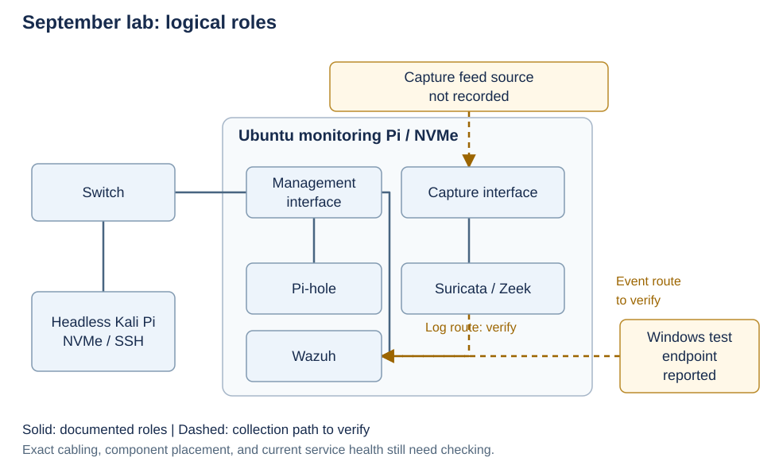
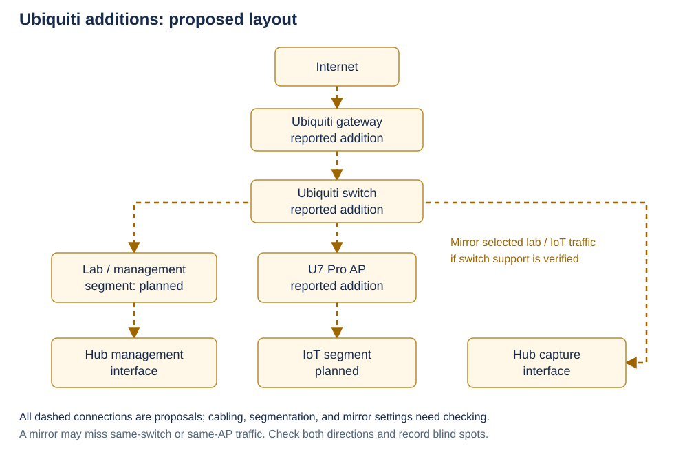

# My home SOC lab

[Back to my profile](../README.md)

This walkthrough covers how my Raspberry Pi lab changed, how the monitoring fits together, and a Windows test I still need to run and document.

The build notes come from my [September README](https://github.com/EminYerom/EminYerom/blob/b9c8665e3816b72ad8a92cdb00c08079a785c036/README.md); the recent hardware additions are based on what I've reported. As of October 12, 2026, the original logs, screenshots, and configuration exports aren't published here. The live setup wasn't checked for this walkthrough. The test below is a new procedure, not a record of the September test.

## Where the lab stands

| Area | What I've documented or reported | What I still need to check |
| --- | --- | --- |
| Ubuntu monitoring Pi: Wazuh, Suricata, Zeek, Pi-hole; separate management and capture interfaces | Built and described in September | Current versions, service health, collection settings, and coverage |
| Headless Kali Pi on NVMe, connected to the switch and accessed through SSH | Built and described in September | Current connectivity and operating state |
| Network events in Wazuh and a Windows process test in the dashboard | Described in my September notes through the README | Source events, matching alert, timestamps, and rule details aren't published |
| Ubiquiti gateway, switch, and U7 Pro AP | Recent additions I've reported | Gateway/switch models, cabling, port roles, and mirror support/settings |
| Segmented IoT monitoring | Planned | Segment policy and a separate traffic-capture test |
| Home Assistant / GPT integration | Planned; not installed | Design and setup, if I pursue it |

## How the build changed

DEF CON 34 pushed me to build a lab of my own. I started with one Pi running Kali and Wazuh. I wanted a portable Kali device, but monitoring needed to stay home and keep collecting logs. I split those jobs between an Ubuntu hub and a separate Kali Pi.

Constant log and index writes raised concerns about SD-card wear and storage performance, so I moved to NVMe. The clone left the hub's boot partitions ambiguous. I used unique partition IDs and checked that it booted with the SD card removed. The capture adapter also failed to appear in Linux; I traced that to its USB connection and corrected the cabling.

I still need to document where the capture feed comes from and which traffic it can see. Getting the adapter recognized was one step; confirming the traffic path is another.

## Lab layout

**September layout**

This is a logical view of the September build. It doesn't establish the exact wiring or where each Wazuh component runs. Dashed lines mark collection paths I still need to verify.



**In text:** the Kali Pi sits on the switch. The Ubuntu hub has separate management and capture interfaces, with Wazuh, Pi-hole, Suricata, and Zeek. I still need to verify the capture-feed source and the log route into Wazuh. My notes describe a Windows process test reaching the dashboard, but I haven't published its collection settings. I also need to check which clients actually use Pi-hole for DNS.

**Proposed layout with the Ubiquiti additions**

I've added a Ubiquiti gateway, switch, and U7 Pro AP. This is the layout to work toward; all connections below are proposed until I check the wiring, segmentation, and mirror support. The segment names show intended roles, not configured VLANs.



**In text:** internet → gateway → switch → AP. A lab/management segment would reach the hub's management interface; an IoT segment would use the AP. If the switch supports the required mirroring, selected lab/IoT traffic would be copied to the capture interface.

An uplink mirror can miss traffic between devices on the same switch or AP. I need to check both traffic directions and record those blind spots before calling IoT monitoring operational.

## Windows test to run

**Not run for this walkthrough.** The path I want to check is:

`cmd.exe marker → Sysmon Event ID 1 → Wazuh agent → manager rule → indexed alert → dashboard`

The command prints a unique marker and exits. It makes no network request. A matching alert would show that this endpoint's event reached Wazuh and matched the test rule. It wouldn't establish attack detection or Suricata/Zeek/IoT coverage.

**Before running it**

- Use one Windows lab endpoint I own, with Sysmon and an enrolled Wazuh agent already working. Sysmon must include the test's `cmd.exe` process creation and full command line. [Microsoft's Event ID 1 and filtering reference](https://learn.microsoft.com/en-us/sysinternals/downloads/sysmon) describes the source event.
- Check that the agent collects `Microsoft-Windows-Sysmon/Operational` as `eventchannel`, as described in [Wazuh's collection guide](https://documentation.wazuh.com/current/user-manual/capabilities/log-data-collection/configuration.html).
- Record Wazuh/Sysmon versions and check decoded field names, synchronized clocks, indexing, and the alert threshold. No active response should act on this test marker/rule.
- Review, validate, and load the test rule before running the marker. If anything is missing, record **blocked** and handle setup separately. Nothing was installed or changed on the lab for this document.

The agent needs this collection block. Check the existing configuration for it before adding anything:

```xml
<localfile>
  <location>Microsoft-Windows-Sysmon/Operational</location>
  <log_format>eventchannel</log_format>
</localfile>
```

**Test rule to review; not deployed:** this custom group would go in `/var/ossec/etc/rules/local_rules.xml`, keeping existing rules. `100110` is an example; check that the ID is unused or choose another in the custom range. [Wazuh's custom-rule guide](https://documentation.wazuh.com/current/user-manual/ruleset/rules/custom.html) covers validation and the manager restart needed to activate changes.

```xml
<group name="local,portfolio_test,">
  <rule id="100110" level="5">
    <if_group>sysmon_event1</if_group>
    <field name="win.eventdata.commandLine" type="pcre2">SOC-PORTFOLIO-TEST-[0-9a-f]{32}</field>
    <description>Portfolio lab: benign process marker observed</description>
  </rule>
</group>
```

The group comes from the [Wazuh 4.14.0 Sysmon ruleset](https://github.com/wazuh/wazuh/blob/v4.14.0/ruleset/rules/0595-win-sysmon_rules.xml); the command-line field is used in Wazuh's [Windows utility examples](https://wazuh.com/blog/monitoring-commonly-abused-windows-utilities/). I still need to check these against my installed version, including the field's case, and validate the rule in Wazuh's rule-testing facility. A process event alone may be informational and produce no indexed alert.

**Procedure**

1. Record the UTC start time, endpoint alias (for example, `WIN-LAB`), versions, and actual test-rule ID. Use a fresh marker for each run.
2. On that endpoint, run this in an interactive PowerShell session:

   ```powershell
   $marker = 'SOC-PORTFOLIO-TEST-' + [guid]::NewGuid().ToString('N')
   [DateTime]::UtcNow.ToString('o')
   $marker
   & "$env:SystemRoot\System32\cmd.exe" /d /c "echo $marker"
   ```

3. In Event Viewer, open **Applications and Services Logs → Microsoft → Windows → Sysmon → Operational**. Find **Event ID 1** for the child `cmd.exe` with the exact marker in `CommandLine`. Save its UTC timestamp and event record ID; retain its process GUID privately for correlation.
4. In the Wazuh dashboard's alert view, select a time window covering the run and filter by the actual test-rule ID and the endpoint. Inspect the alert's command-line field (commonly `data.win.eventdata.commandLine`) for the same marker. Record rule ID, level, source event time, alert time, and dashboard visibility time. Field paths and UI labels must be checked against the installed version.
5. Mark **pass** when the source event and indexed alert contain the same marker and refer to the same endpoint. Record the observed delay. If the local event exists but no alert appears after a recorded observation window (start with five minutes), mark **incomplete** and check the pipeline.

| Gap | Next check |
| --- | --- |
| No local Sysmon event | Process-create filtering, channel availability, and command execution |
| Local event exists; no manager alert | Agent channel collection and transport, decoder field case, rule loading/match, and alert threshold |
| Manager alert exists; dashboard has no match | Indexing/forwarding, selected data view, endpoint filter, and time window |

The process exits and creates no test file. If I add a temporary rule for the run, I'll remove only that rule after collecting evidence and follow the normal manager activation procedure. I'll record configuration changes with the result.

## Evidence I still need to collect

These are all pending. I'll keep the originals private and publish reviewed excerpts with personal details removed.

- [ ] A dated run note: marker, endpoint alias, UTC window, versions, actual rule ID, result (**pass / incomplete / blocked**), and observed delay.
- [ ] A source-event excerpt showing Sysmon Event ID 1, timestamp, record ID, `cmd.exe`, and the marker.
- [ ] A matching Wazuh alert excerpt showing event time, marker, rule ID/level, and the same endpoint alias.
- [ ] A cropped dashboard screenshot showing that alert and the selected time window, with no unrelated events.
- [ ] Reviewed collection/rule excerpts and configuration validation notes supporting the tested path.
- [ ] A separate dated topology check: confirmed device models, management/capture roles, mirror source/destination/direction, and visibility limits. The Windows test cannot satisfy this item.

Before publishing, I'll replace host/user names, addresses, agent/account identifiers, and device labels with consistent aliases. I'll remove secrets, serial numbers, personal paths, cloud identifiers, unrelated traffic, and household-device details, including anything in event messages or screenshot sidebars. The marker, rule details, and timing needed for correlation can stay; changed fields should be labeled. Raw EVTX files, PCAPs, and full private traffic logs will stay private.

My next step is one documented Windows run, followed by checking the Ubiquiti wiring and mirror support and updating the diagram. IoT visibility needs its own test with owned lab traffic before I can call that part working.
