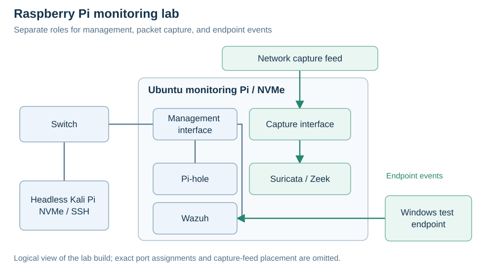

# My home SOC lab

[Back to my profile](../README.md)

I built this lab to work with security logs and network traffic at home. It started with one Raspberry Pi running Kali and Wazuh and grew into a dedicated monitoring hub and a separate Kali Pi.

## The setup

| Component | Role |
| --- | --- |
| Ubuntu monitoring Pi on NVMe | Wazuh, Suricata, Zeek, and Pi-hole |
| Management interface | Access to the monitoring hub |
| Separate capture interface | Traffic capture for network monitoring |
| Headless Kali Pi on NVMe | Separate Linux lab device, connected to the switch and accessed through SSH |
| Windows test endpoint | Controlled process-monitoring test |



The diagram shows the lab's roles rather than exact port assignments. The switch connects the Kali Pi and the hub's management side. The capture interface handles network monitoring separately, while Windows events provide endpoint telemetry to Wazuh.

## What I worked through

I wanted a portable Kali device, but monitoring needed to stay home and keep collecting logs. I split those jobs between two Pis instead of keeping everything on one device.

Constant log and index writes raised concerns about SD-card wear and storage performance, so I moved to NVMe. After cloning the storage, the hub's boot partitions were ambiguous. I used unique partition IDs and checked that it booted with the SD card removed.

The capture adapter also failed to appear in Linux. I traced that to its USB connection and corrected the cabling. That meant checking the connection before spending more time on sensor configuration.

## Checks during the build

| Work | What I checked |
| --- | --- |
| Pi-hole DNS filtering | An ordinary domain resolved and a test domain was blocked, both locally on the hub and from Kali |
| UniFi syslog receiver | Backed up the Wazuh configuration, passed `wazuh-analysisd -t`, restarted the manager, and verified UDP and TCP listeners on port 514 on September 22, 2026 |
| Wazuh monitoring | My September project log records network events and a controlled Windows process test appearing in the dashboard |
| Python health check | Ran a script to inspect service state, log freshness, Wazuh alerts, Suricata records, and both network interfaces |

## Repeatable Windows check

The earlier Windows test appeared in Wazuh's dashboard. This is a separate procedure for repeating that kind of check with a unique marker; it hasn't been run as written here.

`cmd.exe marker → Sysmon Event ID 1 → Wazuh agent → manager rule → alert → dashboard`

<details>
<summary>Test setup and steps</summary>

**Setup:** use an owned Windows lab endpoint with Sysmon process-creation logging and an enrolled Wazuh agent collecting `Microsoft-Windows-Sysmon/Operational`. Check that the test rule is loaded, its level meets the alert threshold, and no active response acts on it. Keep the clocks synchronized and use the field names from the installed decoder.

The agent's channel-collection block is:

```xml
<localfile>
  <location>Microsoft-Windows-Sysmon/Operational</location>
  <log_format>eventchannel</log_format>
</localfile>
```

This proposed custom rule matches the marker in a Sysmon process event. It hasn't been deployed. Use an unused custom ID and validate it against the installed ruleset before adding it to `/var/ossec/etc/rules/local_rules.xml`:

```xml
<group name="local,portfolio_test,">
  <rule id="100110" level="5">
    <if_group>sysmon_event1</if_group>
    <field name="win.eventdata.commandLine" type="pcre2">SOC-PORTFOLIO-TEST-[0-9a-f]{32}</field>
    <description>Portfolio lab: benign process marker observed</description>
  </rule>
</group>
```

1. Record the UTC start time, endpoint alias, versions, and actual rule ID.
2. Run the following in an interactive PowerShell session on that endpoint. It prints a marker and exits without making a network request:

   ```powershell
   $marker = 'SOC-PORTFOLIO-TEST-' + [guid]::NewGuid().ToString('N')
   [DateTime]::UtcNow.ToString('o')
   $marker
   & "$env:SystemRoot\System32\cmd.exe" /d /c "echo $marker"
   ```

3. In Event Viewer, find **Sysmon → Operational → Event ID 1** for `cmd.exe` with that marker in `CommandLine`.
4. In Wazuh, select the test's time window and endpoint, then filter by the actual rule ID. Match the same marker in the alert's command-line field, commonly `data.win.eventdata.commandLine`.
5. Record whether the source event and alert match, along with the observed delay. Keep a small source-event excerpt and a cropped alert screenshot, using consistent aliases for personal details. If no alert appears within a recorded observation window, use the checks below. Remove only the temporary test rule afterward if it was added for this run, following Wazuh's normal activation procedure.

| Where the event stops | What to check |
| --- | --- |
| No local Sysmon event | Process-creation filtering and command execution |
| Local event, no Wazuh alert | Channel collection, agent transport, decoded fields, rule loading, and alert threshold |
| Manager alert, no dashboard result | Indexing, selected data view, endpoint filter, and time window |

A matching alert checks this endpoint's collection path and the marker rule. Network-capture coverage needs a separate test.

References: [Microsoft Sysmon](https://learn.microsoft.com/en-us/sysinternals/downloads/sysmon), [Wazuh event collection](https://documentation.wazuh.com/current/user-manual/capabilities/log-data-collection/configuration.html), [custom rules](https://documentation.wazuh.com/current/user-manual/ruleset/rules/custom.html), [Sysmon rule group](https://github.com/wazuh/wazuh/blob/v4.14.0/ruleset/rules/0595-win-sysmon_rules.xml), and [command-line field examples](https://wazuh.com/blog/monitoring-commonly-abused-windows-utilities/).

</details>

I've also added a Ubiquiti gateway, switch, and U7 Pro AP. Segmented IoT monitoring is the next networking goal; it needs its own capture and visibility checks.
